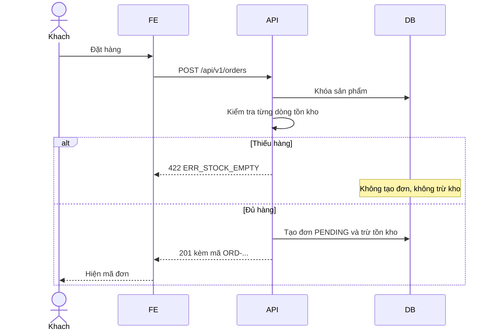
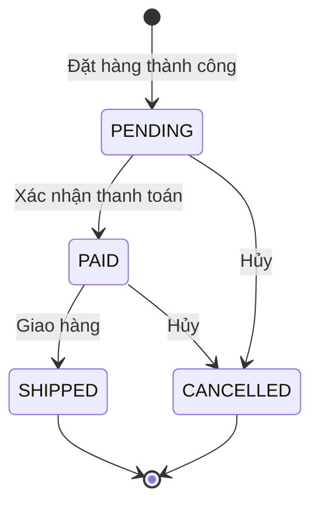
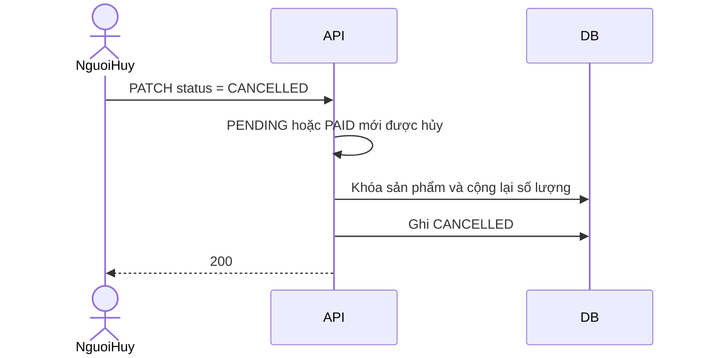

# Phân tích nghiệp vụ — AnNam Shop

Cửa hàng bán đồ dùng nhà. Ba module: khách hàng, danh mục và sản phẩm, giỏ hàng và đơn hàng. Tài liệu này khóa quy tắc trước khi viết API và code.

## Tác nhân

| Tác nhân | Việc được làm |
| --- | --- |
| Khách vãng lai | Xem danh mục, tìm và lọc sản phẩm |
| Khách hàng | Đăng ký, đăng nhập, sửa hồ sơ, giỏ hàng, đặt hàng, xem lịch sử, hủy đơn của mình khi đơn còn hủy được |
| Quản trị | Tạo và sửa danh mục, sản phẩm, tồn kho; xem mọi đơn; chuyển PENDING → PAID → SHIPPED hoặc hủy |

## Quy tắc dùng chung

- Giá là số nguyên VND. Giá trên đơn là giá tại lúc đặt, client không được gửi giá.
- Email phải đúng định dạng và là duy nhất, lưu chữ thường.
- Số điện thoại Việt Nam: `0` hoặc `+84`, tiếp theo là 3, 5, 7, 8 hoặc 9, rồi đúng 8 chữ số. Ví dụ `0901234567`. Số điện thoại là duy nhất.
- Mật khẩu tối thiểu 8 ký tự, có ít nhất một chữ và một số. Mật khẩu được băm, không trả về API.
- Sai định dạng trả `400` với `ERR_VALIDATION`. Vi phạm nghiệp vụ trả `422`. Không thấy dữ liệu trả `404`.
- Body lỗi luôn là `{ "code", "message", "details": [{ "field", "issue" }] }`.

## Module khách hàng

### US-C01 Đăng ký

Là khách vãng lai, tôi muốn đăng ký bằng họ tên, email, số điện thoại và mật khẩu, để giữ địa chỉ và theo dõi đơn.

- Thiếu hoặc sai email, số điện thoại, mật khẩu: `400 ERR_VALIDATION`, `details` chỉ đúng trường.
- Trùng email: `422 ERR_EMAIL_EXISTS`. Trùng số điện thoại: `422 ERR_PHONE_EXISTS`.
- Thành công: `201`, có hồ sơ, không có mật khẩu. Hệ thống tạo một giỏ hàng trống.

### US-C02 Đăng nhập

Là khách đã đăng ký, tôi muốn đăng nhập, để gọi các API của mình.

- Đúng email và mật khẩu: `201`, trả JWT và hồ sơ.
- Sai email hoặc sai mật khẩu: cùng một thông báo `401 ERR_INVALID_CREDENTIALS`.
- API cá nhân không có token, hoặc token hỏng: `401 ERR_UNAUTHORIZED`.

### US-C03 Hồ sơ

Là khách hàng, tôi muốn xem và sửa họ tên, số điện thoại, địa chỉ.

- `GET /api/v1/customers/me` và `PUT /api/v1/customers/me`.
- Email không đổi qua API này.
- Số điện thoại mới vẫn phải đúng định dạng và chưa thuộc người khác.

### US-C04 Lịch sử đơn

Là khách hàng, tôi muốn xem các đơn của mình, mới nhất trước.

- `GET /api/v1/customers/me/orders` có phân trang.
- Khách không gọi được danh sách mọi đơn của cửa hàng.

## Module danh mục và sản phẩm

Sản phẩm có tên, mô tả, giá, ảnh, số lượng tồn và một danh mục.

### US-P01 Xem và tìm hàng

Là khách, tôi muốn tìm theo từ khóa, lọc danh mục, lọc khoảng giá và phân trang.

- `GET /api/v1/products` nhận `q`, `categoryId`, `minPrice`, `maxPrice`, `page`, `size`, `sort`.
- `sort` chỉ nhận `newest`, `priceAsc`, `priceDesc`, `name`.
- `page` bắt đầu từ 0, `size` từ 1 đến 60. Ngoài khoảng đó: `400`.
- Không có hàng phù hợp vẫn là `200` với `content` rỗng.
- Không có token vẫn xem được danh mục và sản phẩm.

### US-P02 Chi tiết và tồn kho

Là khách, tôi muốn thấy còn bao nhiêu cái trước khi bỏ vào giỏ.

- `GET /api/v1/products/{id}`.
- Id không có: `404 ERR_NOT_FOUND`.
- Tồn bằng 0 vẫn xem được, nhưng không đặt được khi checkout.

### US-P03 Quản trị danh mục

Là quản trị, tôi muốn thêm, sửa, xóa danh mục.

- Tên danh mục là duy nhất, không phân biệt hoa thường.
- Xóa danh mục đang có sản phẩm: `422 ERR_CATEGORY_IN_USE`.
- Khách gọi API ghi: `403 ERR_FORBIDDEN`.

### US-P04 Quản trị sản phẩm và tồn kho

Là quản trị, tôi muốn tạo sản phẩm, sửa tồn kho và xóa sản phẩm chưa phát sinh đơn.

- Giá lớn hơn 0. Tồn kho không âm.
- `PATCH /api/v1/products/{id}` chỉ đổi `stockQuantity`.
- Sản phẩm đã có trong đơn hàng: `422 ERR_PRODUCT_IN_USE`. Xóa sản phẩm cũng gỡ dòng đó khỏi các giỏ hàng.

## Module giỏ hàng và đơn hàng

Giỏ thuộc về một khách. Thêm cùng một sản phẩm thì cộng số lượng, không tạo dòng mới. Số lượng mỗi dòng từ 1 đến 99. Giỏ được phép chứa nhiều hơn tồn kho hiện tại, vì tồn kho có thể đổi trước lúc đặt. Lúc này giao diện cảnh báo, còn việc từ chối xảy ra ở checkout.

### US-O01 Sửa giỏ

Là khách hàng, tôi muốn thêm, đổi số lượng và xóa dòng trong giỏ.

- `GET /api/v1/carts/me`
- `POST /api/v1/carts/me/items`
- `PUT /api/v1/carts/me/items/{itemId}`
- `DELETE /api/v1/carts/me/items/{itemId}` trả `204`.

### US-O02 Đặt hàng

Là khách hàng, tôi muốn đặt hàng từ giỏ, để nhận một mã đơn và biết đơn đang chờ xử lý.

Trong **một giao dịch**:

1. Khóa từng sản phẩm trong giỏ theo thứ tự id.
2. Kiểm tra toàn bộ dòng. Dòng nào thiếu hàng thì ghi vào `details`, chưa trừ kho dòng nào.
3. Nếu thiếu: `422 ERR_STOCK_EMPTY`, message đúng là `Sản phẩm đã hết hàng`. Giỏ giữ nguyên.
4. Nếu đủ: tính tổng bằng giá hiện tại nhân số lượng, tạo đơn `PENDING`, trừ tồn kho, xóa giỏ.
5. Trả `201` với mã `ORD-YYYYMMDD-XXXXXXXX`.

Không có địa chỉ trên hồ sơ và cũng không gửi địa chỉ: `400`. Giỏ trống: `422 ERR_CART_EMPTY`.

### US-O03 Chuyển trạng thái

Là quản trị, tôi muốn đẩy đơn theo đúng thứ tự, để không giao một đơn chưa thanh toán.

| Từ | Được sang |
| --- | --- |
| PENDING | PAID, CANCELLED |
| PAID | SHIPPED, CANCELLED |
| SHIPPED | không |
| CANCELLED | không |

- Nhảy cóc, ví dụ PENDING thẳng sang SHIPPED: `422 ERR_INVALID_STATUS`.
- Khách không được chuyển sang PAID hoặc SHIPPED: `403`.
- Quản trị xem mọi đơn qua `GET /api/v1/orders`, có lọc `status`.

### US-O04 Hủy đơn và hoàn kho

Là khách hoặc quản trị, tôi muốn hủy đơn còn ở PENDING hoặc PAID, để hàng quay lại kho.

Hoàn kho và đổi trạng thái nằm trong cùng một giao dịch. Hủy đơn đã giao bị từ chối, tồn kho không đổi. Khách chỉ hủy đơn của mình.

## Ngoài phạm vi

Thanh toán cổng bên thứ ba, vận chuyển, đánh giá sản phẩm và khuyến mãi không nằm trong đồ án này. `PAID` là xác nhận của quản trị, không phải giao dịch ngân hàng.
